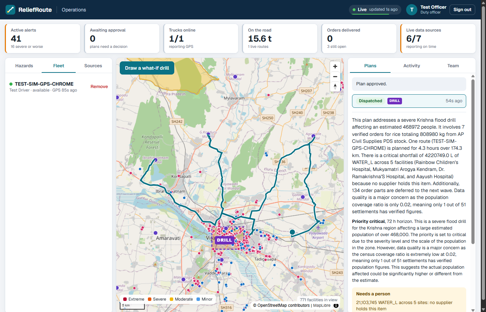
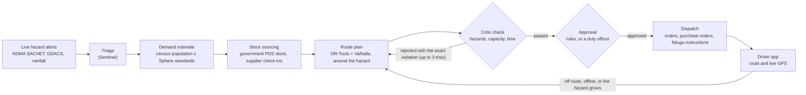
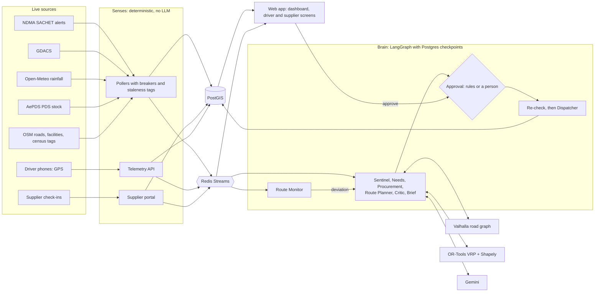

# ReliefRoute

**The problem:** when a cyclone or flood hits Andhra Pradesh, relief officers must quickly work out who is cut off, what those people need, where real stock is, and which roads are still safe.
**Who it's for:** district duty officers who plan relief, the truck drivers who carry it, and the suppliers who hold stock.
**What it does:** it reads live government hazard alerts, estimates the water and food an affected area needs, finds real stock (including government ration stock), and plans truck routes that keep clear of the hazard.
**Who decides:** a safety check tests every plan. Plans approve themselves only by plain rules, and anything unclear waits for a duty officer before it is dispatched to the driver's phone.
**Where it stands:** a working prototype built for a Gen-AI buildathon. It runs live from one laptop, and has not been deployed for real use. See [Known limitations](#known-limitations).



## From alert to driver



1. **Triage (Sentinel)** reads an alert and decides how urgent it is. A severe flood-type alert, or a drill drawn by an operator, starts a plan by itself.
2. **Demand estimate (Needs)** turns the census population in the zone into water and food per relief point, using Sphere humanitarian standards: 15 L of water and 2,100 kcal of food per person per day.
3. **Stock sourcing (Procurement)** finds the nearest real stock and splits it across suppliers. If there isn't enough, the shortfall goes to a person; nothing is invented.
4. **Route plan** solves the pickups and deliveries with OR-Tools on Valhalla's road graph, with the hazard polygons excluded.
5. **Critic** re-checks every route against the current hazards, truck capacity and time limits, and sends it back with the exact violation.
6. **Approval.** Plain rules in [`backend/app/agents/approval.py`](backend/app/agents/approval.py) decide whether a plan can go by itself. A real extreme alert, stale hazard data, an unverified supplier, the AI being unsure or unavailable, a route close to a hazard, and several other reasons each send it to a duty officer. The AI can add a person but never remove one. `AUTO_APPROVE=false` sends every plan to a person. The plan is re-checked after approval, so a stale one is never dispatched.
7. **Dispatch** writes orders and routes exactly once, translates driver instructions into Telugu (checking that every number survives), and creates purchase-order PDFs.
8. **Route Monitor** follows each truck by GPS. A truck going off route or offline, or a hazard spreading across the road, starts a replan.

**LLMs reason, solvers compute.** Gemini triages alerts, writes the brief for the duty officer and translates driver instructions. OR-Tools plans the routes and Shapely checks them. The LLM never supplies a coordinate, distance or stock figure.

## How we built it

The rules for the whole build are in [docs/MASTER_PROMPT.md](docs/MASTER_PROMPT.md).

- **Two halves, each owning its own files.** The master prompt set the work up as two parallel Claude Code instances under a human owner:
  - **A, "Brain"**: the planning engine. Agents, the LangGraph graph, solvers, routing, dispatch, and the plans API.
  - **B, "Senses & Face"**: live data ingestion, vehicle telemetry, the supplier portal, the web app with its live map and driver screen, and the infrastructure.

  [contracts/ownership.txt](contracts/ownership.txt) says who may touch which path, and a tool checks it at every gate.
- **Shared contracts, frozen after Gate 0.** [contracts/](contracts/README.md) holds the shared agreement: the database schema, the Redis Streams event catalogue, the OpenAPI REST contract, and a Python package both halves import. Neither half writes the other's tables; they read each other's data through `v_*` views. A change is written up in [contracts/requests/](contracts/requests/) for the human owner to decide: 2 are approved and applied, and 10 are pending review.
- **Gated milestones.** Five gates, each ending with a written report in [docs/gates/](docs/gates/): what was built, the commands run with their real output, a self-audit (no fake data in runtime code, no secrets, ownership respected), and known gaps. Work stopped at each gate until the owner said to continue.
- **Written handoff.** [docs/HANDOFF.md](docs/HANDOFF.md) is where to start when picking the project up: branches, gate status, what is left and who it needs, and facts that cost time to learn.
- **Branches.** Each half worked on its own branch (`feat/brain`, `feat/senses-face`), then on integration branches (`integration/gate2`, `integration/gate3`), all now merged into `main`. From Gate 3 on, one worker carried both roles on one integration branch, with commits still scoped per owner.

## Gate status

As recorded in [docs/HANDOFF.md](docs/HANDOFF.md) (status on 2026-10-31):

| Gate | Status |
|---|---|
| 0 Contracts and skeleton | ✅ |
| 1 Live data, map, routing | ✅ |
| 2 Pipeline, approval, driver and supplier apps | 🟡 Proven live end to end, except the two items in §3 |
| 3 Closed loop and edge cases | 🟡 Built and proven live with labelled simulated vehicles |
| 4 Polish, docs, deploy | 🟡 Docs done. Security reviewed and hardened. Production stack rehearsed end to end on this machine. Not deployed |

Gates 2 and 3 are not tagged because they aren't fully verified. The main missing piece is a real phone reporting GPS from inside Andhra Pradesh; simulated trucks don't count. The reports behind each gate:

| Gate | Reports |
|---|---|
| 0 | [A-G0](docs/gates/A-G0.md) |
| 1 | [A-G1](docs/gates/A-G1.md), [B-G1](docs/gates/B-G1.md) |
| 2 | [A-G2](docs/gates/A-G2.md), [B-G2](docs/gates/B-G2.md) |
| 3 | [A-G3](docs/gates/A-G3.md), [B-G3](docs/gates/B-G3.md) |
| 4 | [A-G4](docs/gates/A-G4.md), [A-G4-security](docs/gates/A-G4-security.md), [B-G4](docs/gates/B-G4.md), [B-G5-web-app](docs/gates/B-G5-web-app.md) |

After that table was written, a full audit on 2026-11-01 ([docs/FINAL_TESTING_AND_DEPLOYMENT_READINESS.md](docs/FINAL_TESTING_AND_DEPLOYMENT_READINESS.md)) found the system **ready with conditions**. The web app has since been put on Vercel, where it reaches the full stack on a laptop through a tunnel ([docs/deploy-vercel-render.md](docs/deploy-vercel-render.md)). What is left is in [docs/REMAINING_WORK.md](docs/REMAINING_WORK.md).

## Key numbers

Verified on 2026-11-11 on `main` (`400e07c`), against real PostGIS, Redis and the Andhra Pradesh road graph in Valhalla, with Python 3.12 on Windows:

| Check | Result |
|---|---|
| Backend, whole suite (`pytest`, 611 tests) | **608 passed, 2 failed, 1 skipped**, in 18 minutes |
| Backend, unit tests only (`-m "not integration"`) | 362 passed, 8 skipped |
| Driver offline queue (`node --test tests/queue.test.mjs`) | 6 passed |
| No fake data in runtime code (`contracts/tools/audit_runtime.py`) | 0 findings |

Every test that runs on local data passed. The three that did not pass are the only ones that download live NDMA SACHET alerts ([live_sources.py](backend/tests/brain/live_sources.py)), so their result depends on SACHET and on that day's alerts:

| Test | Result | Why |
|---|---|---|
| `test_live_hazard_through_full_routing_pipeline` | Failed | No current alert lay inside the Andhra Pradesh road graph |
| `test_real_route_avoids_real_hazard` | Failed | SACHET closed the connection without answering |
| `test_matrix_respects_exclusions` | Skipped | SACHET was rate-limiting this IP (HTTP 403) |

A second full run gave the same totals. Every gate report records these three as skipped, for the same rate limit. Two of them fail rather than skip when the day's alerts give them nothing to route around.

The test count grew with each gate. The figures below are from the reports:

| When | Backend tests | Source |
|---|---|---|
| Gate 2 | 155 passed, 3 skipped | [A-G2](docs/gates/A-G2.md), [B-G2](docs/gates/B-G2.md) |
| Gate 3 | 288 passed, 3 skipped | [A-G3](docs/gates/A-G3.md) |
| Gate 4 security review | 409 passed, 3 skipped | [A-G4-security](docs/gates/A-G4-security.md) |
| Readiness audit, 2026-11-01 | 553 passed, 3 skipped, 1 failed (a flaw in the test, fixed) | [readiness audit](docs/FINAL_TESTING_AND_DEPLOYMENT_READINESS.md) |

Browser tests (Playwright, `frontend/tests/e2e`) were not run for this README. The last recorded run was 26 passed, 13 skipped (readiness audit, 2026-11-01).

## Known limitations

- **No real water stock.** There is no public source for drinking-water stock, so water reaches a plan only through a supplier's check-in. [`infra/demo/seed_demo_water.py`](infra/demo/seed_demo_water.py) can add 50,000 L for a demo. Its suppliers are named "DEMO SEED (not real stock)" and stay unverified, so any plan that uses them always waits for a person, even in presentation mode. It was run on the Gate 2 machine. The handoff of 2026-10-31 says it was not run on the current one. If it is used for a demo, say so.
- **Population is an estimate.** It comes from OSM census tags, which cover about 2.7% of settlements, so rural areas are undercounted. At Gate 2, a whole city counted when its centre fell in the zone. Vijayawada became 1,048,240 people, and demand came to about 1,135 t, which is unrealistic. **This is fixed:** a city or town is now scaled by the share of its mandal that the zone covers, so the same kind of drill gave 468,972 people for a zone covering 44.7% of the mandal ([A-G2](docs/gates/A-G2.md), [A-G3](docs/gates/A-G3.md)). Two integration tests cover this in [test_integration_closed_loop.py](backend/tests/brain/test_integration_closed_loop.py). What remains:
  - the scaling assumes people are spread evenly across the mandal;
  - a zone that covers a whole mandal still counts the whole city;
  - villages count in full.

  Every plan shows its coverage. A better source such as WorldPop needs a contract change.
- **Simulated trucks in presentation mode.** `stack.ps1 demo` runs 42 simulated trucks, labelled `TEST-SIM-GPS` on every screen. In this mode a plan that moves only simulated trucks skips the person, unless it uses an unverified supplier. No real phone has reported GPS from inside Andhra Pradesh yet.
- **Approval is by rule by default** (`AUTO_APPROVE=true`). Clear plans are dispatched without a person; see step 6 above. Before approving, a duty officer sees the demand, the safety result and the summary, but not the proposed routes or orders: those are written only at dispatch ([readiness audit](docs/FINAL_TESTING_AND_DEPLOYMENT_READINESS.md), §10).
- **Not deployed for real use.** The production compose stack has only run on this laptop, with no real domain or certificate. The hosted web app depends on the laptop, Docker and a tunnel all staying up.
- **Contract changes 002 to 010 are pending review**, so `contracts/openapi.yaml` does not yet describe the endpoints they add.
- **Messages.** SMS and WhatsApp use Twilio, which is a Trial account here: no real message has been sent, and drills send nothing by design. Email works against a real SMTP server, but delivery through a real provider is untested.
- **Data gaps.**
  - SACHET blocks polygon downloads when they come too fast, so alerts are often placed on OSM boundaries by their area names, labelled as such.
  - PDS stock sits at a point inside each mandal, because shop locations aren't published.
  - About 36 AePDS offices are skipped because their names can't be matched with certainty.
  - NASA FIRMS fire data is off until a valid `FIRMS_MAP_KEY` is set.
  - IMD direct, CWC/India-WRIS and Data.gov.in godowns are not wired.
- **Planning limits.**
  - If a supplier is cut off after dispatch, the goods are escalated to a person, not bought elsewhere.
  - Crash recovery assumes one brain worker.
  - Telugu and Hindi voice depend on the voices installed on the driver's phone.

## Architecture



Ingestion is deterministic and never calls the LLM. Every step a plan takes is written to `agent_events` with the source IDs it used, and the dashboard streams them over SSE. [docs/brain.md](docs/brain.md) and [docs/senses.md](docs/senses.md) have the detail.

### Data sources

| Source | Used for | Status |
|---|---|---|
| [NDMA SACHET](https://sachet.ndma.gov.in/) (CAP) | Official alerts | Live. When SACHET rate-limits polygon downloads, alerts are placed on OSM boundaries by their area names, and labelled as such |
| [GDACS](https://www.gdacs.org/) | Cyclones and floods | Live |
| [Open-Meteo](https://open-meteo.com/) | Forecast rainfall, classified with IMD 24 h categories | Live |
| [AePDS](https://aepos.ap.gov.in/) | Real PDS rice and dal stock per mandal | Live, every 6 h. Pickup points are approximate because shop locations are not published |
| OpenStreetMap ([Geofabrik](https://download.geofabrik.de/asia/india.html)) | Roads, facilities, admin boundaries, census population tags | Official extract. Overpass is tried first for facilities |
| Supplier portal, WhatsApp | Stock reported by real suppliers | Portal live. WhatsApp needs Twilio credentials |
| Driver screen | Real phone GPS | Live |
| NASA FIRMS | Fires | Code ready, off until `FIRMS_MAP_KEY` is set |
| IMD direct, CWC/India-WRIS, Data.gov.in godowns | | **Not wired.** IMD's rainfall categories are applied to Open-Meteo instead |

Sources that are down show as `DATA STALE` on the dashboard, and existing rows are kept. Nothing is filled in with guesses.

## Stack

| Layer | What |
|---|---|
| Web app | Next.js 16, React 19, MapLibre GL 6, TypeScript. One app for sign-in, `/dashboard`, `/driver` and `/supplier` |
| API and workers | Python 3.12, FastAPI, asyncpg, Pydantic 2 |
| Planning | LangGraph with a Postgres checkpointer, OR-Tools (vehicle routing), Shapely (geometry checks), Gemini (reasoning and translation, with labelled rule-based fallbacks) |
| Data | PostgreSQL 16 with PostGIS, Redis Streams |
| Roads | Valhalla, self-hosted, on an OSM extract clipped to Andhra Pradesh |
| Production | Docker Compose behind Caddy on one machine ([docs/deploy.md](docs/deploy.md)); the web app can also run on Vercel or Netlify, with the API on Render |
| CI | GitHub Actions: backend tests on PostGIS and Redis, the no-fake-data audit, type check, lint, build, browser tests, and dependency audits ([ci.yml](.github/workflows/ci.yml)) |

## Setup

You need Docker Desktop with 6 to 8 GB of RAM, Python 3.12 with [`uv`](https://docs.astral.sh/uv/), Node 22, and a [Gemini API key](https://aistudio.google.com/apikey). Allow about 12 GB of disk. The map data lives outside the repo, in `~/reliefroute-data`.

```bash
git clone https://github.com/Dracula-5/SafePassage.git && cd SafePassage
```

**1. Build the map data** (about 15 minutes; needs `osmium-tool`).

```bash
infra/valhalla/build.sh && infra/osm/extract_facilities.sh && infra/osm/extract_places_admin.sh
```

No `osmium` (Windows)? Run the same scripts in a throwaway container from PowerShell:

```powershell
docker run --rm -e DATA_DIR=/data -v "$HOME\reliefroute-data:/data" -v "${PWD}\infra:/infra:ro" debian:bookworm-slim sh -c "apt-get update -qq && apt-get install -y -qq --no-install-recommends bash curl ca-certificates osmium-tool && bash /infra/valhalla/build.sh && bash /infra/osm/extract_facilities.sh && bash /infra/osm/extract_places_admin.sh"
```

**2. Start the services.** The first Valhalla start builds the road graph: about 5 minutes on Linux and macOS, 20 or more on Windows.

```bash
docker compose --profile routing up -d
python3 infra/valhalla/raise_limits.py && docker compose restart valhalla    # required
```

If Windows refuses port 55432 (`bind: An attempt was made to access a socket...`), it has reserved that port. Create a root `.env` with `DB_HOST_PORT=15432` and use that port in `backend/.env`.

**3. Install and configure.**

```bash
uv venv --python 3.12 ~/reliefroute-venv
uv pip install --python ~/reliefroute-venv/bin/python -e contracts/python \
  -r backend/requirements/brain.txt -r backend/requirements/senses.txt -r backend/requirements/dev.txt
cat env/senses.env.example env/brain.env.example > backend/.env     # then set GEMINI_API_KEY
(cd frontend && npm install && cp .env.example .env.local)
```

`backend/.env` now has two `DATABASE_URL`/`REDIS_URL` pairs. Keep only the first pair, which has the right ports. On Windows the interpreter is `~/reliefroute-venv/Scripts/python.exe`.

**4. Run.** On Windows, one command starts everything and `down` stops it:

```powershell
.\infra\dev\stack.ps1 up
```

On Linux and macOS, from `backend/`, each in its own terminal, plus `npm run dev` in `frontend/`:

```bash
~/reliefroute-venv/bin/python -m app.core.migrate
~/reliefroute-venv/bin/uvicorn app.main:app --port 8000
~/reliefroute-venv/bin/python -m app.ingestion.worker
~/reliefroute-venv/bin/python -m app.graph.worker
```

| What | Where |
|---|---|
| ReliefRoute, for everyone | http://localhost:3000 |
| API docs | http://localhost:8000/docs |

The AePDS stock download takes 5 to 10 minutes after the first start.

**Presentation mode.** `.\infra\dev\stack.ps1 demo` runs the production images with 42 simulated trucks across 14 towns, at least 10 of which gather around any drill. They use the public API as a phone does, and everything downstream of them is real. They are marked as simulated on every screen and have no phone numbers. [docs/demo-script.md](docs/demo-script.md) walks through all three roles, and `.\infra\dev\stack.ps1 demo-off` removes the trucks.

**On a phone.** A browser gives GPS only over HTTPS, and the road graph covers only Andhra Pradesh. A phone inside the state can use a temporary tunnel, such as `cloudflared tunnel --protocol http2 --url http://localhost:3000`. Open `https://<tunnel>/signup` and create a driver account. A duty officer must then approve it in the Team tab before the driver can sign in.

## Running tests

Backend, from `backend/`. Integration tests make and drop their own scratch databases, so point them at the development Postgres's `postgres` database. They skip when these URLs are unset, and the routing tests skip without `VALHALLA_URL`.

```bash
cd backend
TEST_DATABASE_URL=postgresql://reliefroute:<password>@localhost:55432/postgres \
TEST_REDIS_URL=redis://localhost:6380/15 VALHALLA_URL=http://localhost:8002 \
~/reliefroute-venv/bin/python -m pytest -q

~/reliefroute-venv/bin/python -m pytest -q -m "not integration"   # unit tests only, no services needed
```

Use port 15432 if you set `DB_HOST_PORT=15432`. The password is the one in `backend/.env`. The whole suite takes 30 to 60 minutes. `tests/*/chaos/` breaks dependencies on purpose: closed ports, servers that hang, garbage from the LLM, and workers dying mid-plan.

Web app, from `frontend/`:

```bash
node --test tests/queue.test.mjs          # the driver's offline GPS queue
npx tsc --noEmit && npx eslint src
OPERATOR_TOKEN=<from backend/.env> npm run test:e2e   # Playwright, against a running stack
```

`E2E_ROUTING=1` adds the drill-to-driver test, and `E2E_DEMO=1` adds the presentation-mode tests. Don't run the browser tests and the backend suite at the same time: they slow each other into false timeouts.

The audit for fake data in runtime code is `python contracts/tools/audit_runtime.py`.

## Deploying

| Option | Guide |
|---|---|
| One 8 GB VM with Docker, a domain and HTTPS, everything behind Caddy, with daily verified backups | [docs/deploy.md](docs/deploy.md) |
| Web app on Vercel, API on Render, or the laptop's full stack through a tunnel | [docs/deploy-vercel-render.md](docs/deploy-vercel-render.md) |
| Web app on Netlify, API on Render | [docs/deploy-render-netlify.md](docs/deploy-render-netlify.md) |
| Free Render API only (no workers, so no live alerts or plans) | [docs/deploy-render-free.md](docs/deploy-render-free.md) |

In production, the API refuses to start if a secret is missing or weak, so a deployment cannot end up open by accident. To try the production images on a Windows PC at http://localhost:3000, run `.\infra\dev\stack.ps1 prod`.

## Security

[docs/security.md](docs/security.md) covers what is protected, who can do what, how to deploy safely, what to do when a phone is lost or a token leaks, and what is not covered. In short:

- Everyone signs up and signs in with an email address, and lands on the screen for their role.
- Anyone can create a supplier account. Duty officer and driver accounts stay pending until an approved duty officer approves them.
- A phone can read only its own route, and an operator can revoke it.
- Drills never message real people unless `DRILL_SEND_MESSAGES=true`.
- New suppliers start unverified, and any plan that uses one needs a person.

## Repository

```
backend/app/agents     Needs, Procurement, Planner, Critic, approval rules, LLM reasoning
backend/app/graph      LangGraph wiring, Dispatcher, Route Monitor, Replanner, evacuations
backend/app/solvers    OR-Tools VRP, Shapely verification
backend/app/routing    Valhalla client
backend/app/ingestion  Pollers for every live source
backend/app/telemetry  Vehicle registration, GPS, driver reports
backend/app/suppliers  Supplier portal
contracts/             Database schema, events and REST contract shared by both halves
frontend/              The web app: sign-in, /dashboard, /driver and /supplier
infra/                 Compose files, map data scripts, deployment, the Windows stack script
docs/                  Master prompt, handoff, gate reports, design notes, demo script, deploy guides
```
