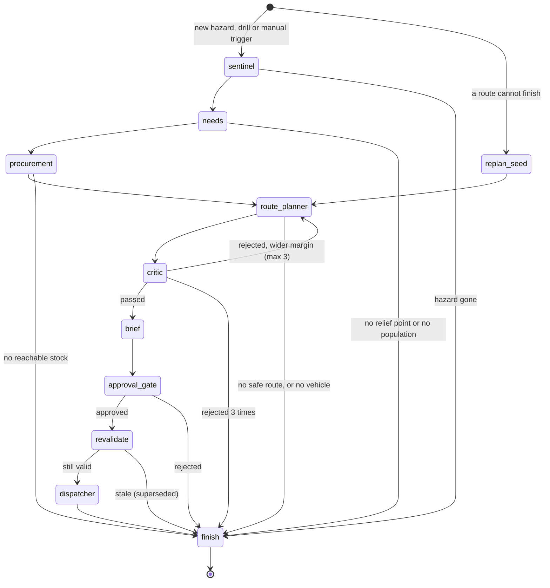

# The Brain

How plans are made, checked, dispatched and repaired. Code: `backend/app/graph`, `agents`, `solvers`, `routing`, `llm`, `dispatch`.

Two rules shape everything here:
- **LLMs reason, solvers compute.** Prompts contain only facts from the database or the solvers, and LLM output is limited to bounded Pydantic models. No coordinate, distance, stock figure or quantity ever comes from a model.
- **Every decision is auditable.** Each step writes to `agent_events` with the source IDs it used. That table is the timeline on the dashboard.

## The graph

LangGraph with a Postgres checkpointer. Each plan is one thread, so a worker can die between any two nodes and carry on.

| Node | Does | Failure behaviour |
|---|---|---|
| Sentinel | LLM triage: priority and planning horizon | Labelled rule-based triage that always asks for human review |
| Needs | Population × Sphere standards × horizon, per relief point | No population or no safe relief point stops the plan rather than guessing |
| Procurement | Greedy split by hazard-aware road time, verified suppliers first | Unmet demand becomes an escalation |
| Route Planner | Valhalla matrix around hazards, OR-Tools pickup and delivery, Valhalla geometry | Router down: stop, because no route can be verified. No safe road: propose an alternate hub |
| Critic | Re-reads current hazards; checks clearance, capacity, time, pickup before dropoff | Exact violations go back to the planner with a wider margin |
| Brief | LLM summary for the approver | Labelled rule-based summary |
| Approval gate | `interrupt()` until a human decides | Plans with no approval reasons continue on their own |
| Revalidate | Re-checks hazards, routes, stock and vehicles; moves ETAs by the delay | Stale plan is superseded, and a fresh plan is requested while the hazard lasts |
| Dispatcher | Orders, routes, translation, PO PDFs, messages | Idempotent. Translation failure sends English; a missing number is logged |

## Planning decisions worth knowing

**Population.** A city has one census figure at one point. Counting all of it for a zone that clips the city overstated demand by orders of magnitude, so a city or town is scaled by the zone's share of its mandal (OSM `admin_level` 6), assuming even density. Suburbs are skipped when their mandal's city is already counted, because the city's figure includes them. Villages count in full: they are small compared with a hazard. The audit trail records the unscaled total and the settlement coverage.

**Waves.** Demand can be far larger than the fleet can move in a day. Each plan routes at most `max_trips_per_vehicle` vehicle loads, shared in rotation across orders so every destination gets something, and no route may exceed `max_shift_hours`. The rest is shown to the approver as "next wave".

**Only carried goods are ordered.** An order with deferred parts is cut down to what a vehicle takes, so stock is not reserved for goods nothing will move.

**Approval reasons.** A plan waits for a human if the Sentinel asks, priority is high or critical, a hazard is severe or extreme, the load exceeds 5 t, a supplier is unverified, it is a drill, or anything is short, unserved or deferred. Replans skip the gate when they only re-route goods already approved.

## The closed loop

`RouteMonitor` (`graph/monitor.py`) consumes `vehicle.telemetry` and `hazard.updated` in its own consumer group, so a long plan run cannot hold up GPS, and sweeps every 30 s for what no event announces.

| Deviation | Detected when | Default |
|---|---|---|
| `off_route` | Fixes stay farther from the route than the threshold or the GPS accuracy, several in a row | 500 m, 3 fixes |
| `stalled` | No movement beyond GPS jitter, on an active route | 15 min |
| `offline` | No fix on an active route | 5 min |
| `hazard_on_route` | A new or changed hazard crosses the road still ahead | |

GPS also moves the route along: reaching a stop (within 300 m) advances `routes.completed_stops`, and orders follow as `in_transit` and then `delivered`. A split order is delivered only when all its parts are. Fixes older than 5 minutes (a phone flushing its offline queue) update nothing.

A deviation goes through four steps:

1. A row in `route_deviations`. A partial unique index allows one open row per route and kind, so a noisy GPS trace cannot start two replans.
2. A `vehicle.deviation` event.
3. A child plan (`trigger_kind = replan`, `parent_plan_id`, `trigger_ref` = the route).
4. The graph enters at `replan_seed`, skipping Sentinel, Needs and Procurement, because the goods are already allocated.

`replan_seed` (`graph/replan.py`) splits what is left of the route:

| Where the goods are | Truck can still drive (`off_route`, `hazard_on_route`) | Truck is lost (`offline`, `stalled`) |
|---|---|---|
| At the supplier | Any vehicle may take them | Any other vehicle may take them |
| On the truck | Stay on it; delivered on a new route | Escalated with the last known position |
| Delivered | Done | Done |

Goods already on board become `deliver` stops tied to that truck, and its free capacity drops by their weight. The parent's orders shrink by what moved, so `v_available_stock` stays correct: stock is reserved exactly once at every step. The driver's phone picks up the new route and reads it aloud.

## Recovery

| Failure | What happens |
|---|---|
| Worker dies mid-plan | The bus redelivers `plan.requested` after 60 s. The plan is already claimed but idle, so the handler continues from the checkpoint. Finished nodes do not re-run |
| Worker dies during dispatch | `plan.approved` is redelivered and the graph continues. Idempotency keys stop duplicates |
| Redis down at approval | The decision is committed first. `requeue_stuck_plans` re-publishes every 30 s once Redis returns |
| Deviation event lost | The sweep retries any open deviation that has no replan |
| Valhalla down | Plan stops with a plain reason. A route that cannot be verified is never issued |
| Gemini down | Labelled rule-based steps, always needing human review. At worker start, it runs with no LLM |
| Langfuse down | Dropped and logged, after a 3 s limit |

Crash recovery assumes one brain worker. Two would both pick up an idle plan.

## Observability

- `agent_events`: the full audit trail, streamed to the dashboard.
- Langfuse: each LLM call as a trace, when `LANGFUSE_PUBLIC_KEY` and `LANGFUSE_SECRET_KEY` are set.
- `GET /api/brain/health`: Valhalla, LLM and Twilio status.
